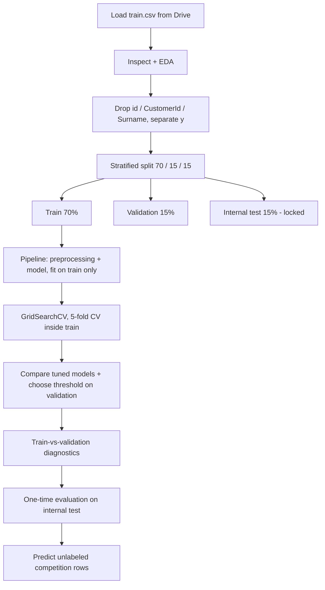

# 01 — Assignment and Workflow | অ্যাসাইনমেন্ট ও ওয়ার্কফ্লো

> **📌 এক নজরে (At a glance)**
> এই প্রজেক্টটি CSE 4101 ল্যাব অ্যাসাইনমেন্ট ১০: একটি ব্যাংক গ্রাহক শেষ পর্যন্ত ব্যাংক ছেড়ে চলে যাবে কি না (`Exited = 1`) তা আগে থেকে অনুমান করা। ডেটা বিভাজন → প্রি-প্রসেসিং → মডেল তুলনা → টিউনিং → একবারমাত্র চূড়ান্ত টেস্ট — এই ক্রমটি কেন গুরুত্বপূর্ণ, তা এই ডকুমেন্টে ব্যাখ্যা করা হয়েছে।
> *This project implements CSE 4101 Lab Assignment 10: predict whether a bank customer exits (`Exited = 1`), following a strict split → preprocess → compare → tune → test-once order.*

## 1. Objective | লক্ষ্য

**বাংলা:** CSE 4101 Practical Lab Assignment 10-এ একটি সম্পূর্ণ ও **leakage-free** মেশিন লার্নিং ওয়ার্কফ্লো তৈরি করতে বলা হয়েছে, যার মাধ্যমে **bank customer churn** (গ্রাহক ব্যাংক ছেড়ে যাওয়া) অনুমান করা হয়। কাজটি *supervised binary classification*: যেসব সারির উত্তর (`Exited`) জানা আছে, মডেল সেগুলো থেকে শেখে; তারপর যে সারি সে আগে কখনো দেখেনি, সেগুলোর ওপর তার মূল্যায়ন করা হয়।

**English:** CSE 4101 Practical Lab Assignment 10 asks for a complete, leakage-free machine-learning workflow that predicts **bank customer churn**: given a customer's attributes, estimate whether they will leave the bank. The task is *supervised binary classification*: the model learns from rows whose answer (`Exited`) is known and is then judged on rows it has never seen.

## 2. Dataset and target | ডেটাসেট ও টার্গেট

**বাংলা:**
* **উৎস:** Kaggle প্রতিযোগিতা *Bank Customer Churn Prediction (2026)* — `train.csv` (লেবেলযুক্ত) ও `test.csv` (লেবেলবিহীন)।
* **Colab-এ অবস্থান:** `/content/drive/MyDrive/Customer Churn Prediction/train.csv`। লোকাল ডেভেলপমেন্ট কপি: `data/train.csv`।
* **টার্গেট:** `Exited` — `1` = গ্রাহক চলে গেছেন (**positive class**), `0` = থেকে গেছেন। CSV-তে এটি `0.0/1.0` ফ্লোট হিসেবে আছে; নোটবুক মান যাচাই করে `int`-এ রূপান্তর করে।
* **প্রকৃত আকার:** লোকাল কপিতে নোটবুক চালিয়ে পাওয়া গেছে ১৫,০০০ সারি × ১৪ কলাম; চার্নার ৩,০৪৬ জন (২০.৩১%)।

**English:**
* Source: Kaggle competition *Bank Customer Churn Prediction (2026)* (`train.csv` labeled, `test.csv` unlabeled).
* Colab location: `/content/drive/MyDrive/Customer Churn Prediction/train.csv`. Local development copy: `data/train.csv`.
* Target: `Exited` — `1` = the customer left (**positive class**), `0` = stayed. In the CSV it is stored as `0.0/1.0` floats; the notebook validates the values and casts to `int`.
* Actual shape found by running the notebook on the local copy: 15,000 rows × 14 columns; 3,046 churners (20.31%).

## 3. Tasks mapped to notebook sections | টাস্ক ও নোটবুক সেকশনের সম্পর্ক

**বাংলা:** অ্যাসাইনমেন্টের ১০টি টাস্ক নোটবুকের ক্রমানুসারে সাজানো। নিচের টেবিলে প্রতিটি টাস্ক কোন সেকশনে আছে এবং কী আউটপুট দেয়, তা দেখানো হলো।
**English:** The ten assignment tasks follow the notebook order; the table shows where each task lives and what it produces.

| Task | টাস্কের নাম (Bangla) | Notebook section | Main output |
|---|---|---|---|
| 1 Load & inspect | ডেটা লোড ও পরিদর্শন | §2–3 | shape, dtypes, missing, duplicates, target distribution, observation |
| 2 EDA | এক্সপ্লোরেটরি ডেটা অ্যানালাইসিস | §4 | 7 plots (6-panel figure + tenure/balance figure), group tables, generated observations |
| 3 Identifiers & leakage | আইডেন্টিফায়ার ও লিকেজ পর্যালোচনা | §5 | decision table (`column / decision / reason`), correlation check, feature list |
| 4 Stratified 70/15/15 split | স্ট্র্যাটিফাইড বিভাজন | §6 | split table, disjointness asserts, churn-rate bar chart |
| 5 Leakage-free preprocessing | লিকেজমুক্ত প্রি-প্রসেসিং | §7 | `ColumnTransformer` pipeline, verification table of train-only statistics, unseen-category probe |
| 6 Three classifiers | তিনটি ক্লাসিফায়ার | §8 | validation comparison table and recorded configurations |
| 7 Hyperparameter tuning | হাইপারপ্যারামিটার টিউনিং | §9 | `GridSearchCV` table of every setting, CV bar plots, selected model, threshold plot |
| 8 Train vs validation | ট্রেইন বনাম ভ্যালিডেশন | §10 | Recall/F1/ROC-AUC table and grouped bar chart |
| 9 Internal test (once) | অভ্যন্তরীণ টেস্ট (একবারমাত্র) | §11 | final metrics, labeled confusion matrix |
| 10 Competition predictions + conclusions | প্রতিযোগিতার ভবিষ্যদ্বাণী ও উপসংহার | §12–13 | five-row prediction table, summary, limitations |

## 4. Workflow | ওয়ার্কফ্লো

**বাংলা:** ডেটা লোড ও পরিদর্শনের পর শনাক্তকারী কলাম (`id`, `CustomerId`, `Surname`) বাদ দেওয়া হয়, তারপর ৭০/১৫/১৫ স্ট্র্যাটিফাইড বিভাজন। প্রশিক্ষণ অংশে প্রি-প্রসেসিংসহ pipeline ফিট হয় এবং 5-fold cross-validation চলে; ভ্যালিডেশনে মডেল ও threshold নির্বাচন হয়; সবশেষে *লক করা* internal test সেট একবার মাত্র ব্যবহৃত হয় এবং লেবেলহীন প্রতিযোগিতার সারিতে ভবিষ্যদ্বাণী করা হয়।

**English:** Load → inspect → drop identifiers → split → (fit preprocessing + models on train, CV inside train) → choose model/threshold on validation → diagnose → single test evaluation → competition inference.

## 5. Why the order matters | ক্রমটি কেন গুরুত্বপূর্ণ

**বাংলা:**
1. **কিছু ফিট করার আগেই ডেটা ভাগ করুন।** Imputer-এর median, scaler-এর mean এবং encoder-এর category — সবই ডেটা থেকে শেখা হয়। সব সারি থেকে শিখলে এগুলোতে validation/test সারির তথ্য ঢুকে পড়ে (**leakage**), ফলে স্কোর বাস্তবের চেয়ে ভালো দেখায়।
2. **টেস্ট সেট ছোঁয়ার আগেই টিউনিং শেষ করুন।** যে সিদ্ধান্ত (মডেল, হাইপারপ্যারামিটার, threshold) কোনো স্কোর দেখে নেওয়া হয়, সেই স্কোর আশাবাদী হয়ে যায়। তাই internal test সেট শুধু *চূড়ান্ত* পছন্দটি দেখে।
3. **চূড়ান্ত টেস্টের আগে ডায়াগনসিস করুন।** Train-vs-validation তুলনা থেকে overfitting বোঝা যায়, এবং এতে এমন ডেটা ব্যবহার হয় যা দেখার অনুমতি আমাদের আছে।

**English:**
1. **Split before fitting anything.** Imputer medians, scaler means and encoder categories are learned from data; if learned from all rows they carry information about validation/test rows (leakage), making scores look better than reality.
2. **Tune before touching the test set.** Every decision (model, hyperparameters, threshold) that is informed by a score makes that score optimistic. The internal test set therefore only ever sees the *final* choice.
3. **Diagnose before the final test.** The train-vs-validation comparison tells us about overfitting using data we are still allowed to look at.

## 6. Requirement checklist | প্রয়োজনীয়তার চেকলিস্ট

**বাংলা:** নিচের টেবিলে প্রতিটি শর্ত কোথায় পূরণ হয়েছে এবং কোনটি বাস্তবে চালানো হয়েছে তা দেখানো হয়েছে। উল্লেখ্য, Drive mount অংশটি ডেভেলপমেন্ট পরিবেশে **চালানো হয়নি** (সেখানে Colab ছিল না)।
**English:** The table shows where each requirement is met and what was actually executed. The Drive-mount branch itself was **not executed** in the development environment (no Colab there).

| Requirement | Where | Status |
|---|---|---|
| Drive-first loading, path check, actionable error | §2 | implemented; Drive mount itself **not executed** (no Colab here) |
| Target validated at runtime | §2 | executed locally |
| ≥3 plots, ≥3 observations | §4 | executed locally |
| Stratified 70/15/15 with seed 42 | §6 | executed locally |
| Preprocessing fitted on train only, inside CV | §7, §9 | executed locally |
| LR, RF, GB compared on Recall, F1, ROC-AUC (+Precision, Accuracy) | §8 | executed locally |
| ≥2 hyperparameters tuned, internal test unused | §9 | executed locally |
| Train vs validation table + chart | §10 | executed locally |
| One-time test evaluation + confusion matrix | §11 | executed locally |
| 5 unlabeled predictions | §12 | executed locally using `data/test.csv`; handled gracefully if absent |
| ≥2 limitations | §13 | written |
