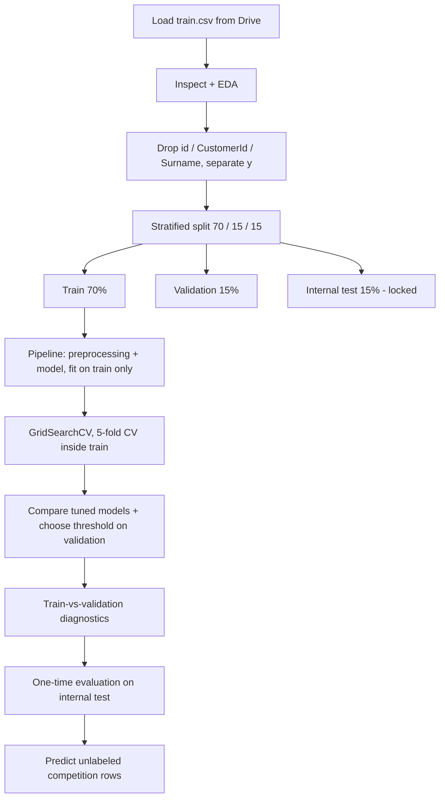

# 01 — Assignment and Workflow

## Objective
CSE 4101 Practical Lab Assignment 10 asks for a complete, leakage-free machine-learning workflow that predicts **bank customer churn**: given a customer's attributes, estimate whether they will leave the bank. The task is *supervised binary classification*: the model learns from rows whose answer (`Exited`) is known and is then judged on rows it has never seen.

## Dataset and target
* Source: Kaggle competition *Bank Customer Churn Prediction (2026)* (`train.csv` labeled, `test.csv` unlabeled).
* Colab location: `/content/drive/MyDrive/Customer Churn Prediction/train.csv`. Local development copy: `data/train.csv`.
* Target: `Exited` — `1` = the customer left (**positive class**), `0` = stayed. In the CSV it is stored as `0.0/1.0` floats; the notebook validates the values and casts to `int`.
* Actual shape found by running the notebook on the local copy: 15,000 rows × 14 columns; 3,046 churners (20.31%).

## Tasks mapped to notebook sections
| Task | Notebook section | Main output |
|---|---|---|
| 1 Load & inspect | §2–3 | shape, dtypes, missing, duplicates, target distribution, observation |
| 2 EDA | §4 | 7 plots (6-panel figure + tenure/balance figure), group tables, generated observations |
| 3 Identifiers & leakage | §5 | decision table (`column / decision / reason`), correlation check, feature list |
| 4 Stratified 70/15/15 split | §6 | split table, disjointness asserts, churn-rate bar chart |
| 5 Leakage-free preprocessing | §7 | `ColumnTransformer` pipeline, verification table of train-only statistics, unseen-category probe |
| 6 Three classifiers | §8 | validation comparison table and recorded configurations |
| 7 Hyperparameter tuning | §9 | `GridSearchCV` table of every setting, CV bar plots, selected model, threshold plot |
| 8 Train vs validation | §10 | Recall/F1/ROC-AUC table and grouped bar chart |
| 9 Internal test (once) | §11 | final metrics, labeled confusion matrix |
| 10 Competition predictions + conclusions | §12–13 | five-row prediction table, summary, limitations |

## Workflow

Plain-text version: load → inspect → drop identifiers → split → (fit preprocessing + models on train, CV inside train) → choose model/threshold on validation → diagnose → single test evaluation → competition inference.

## Why the order matters
1. **Split before fitting anything.** Imputer medians, scaler means and encoder categories are learned from data; if learned from all rows they carry information about validation/test rows (leakage), making scores look better than reality.
2. **Tune before touching the test set.** Every decision (model, hyperparameters, threshold) that is informed by a score makes that score optimistic. The internal test set therefore only ever sees the *final* choice.
3. **Diagnose before the final test.** The train-vs-validation comparison tells us about overfitting using data we are still allowed to look at.

## Requirement checklist
| Requirement | Where | Status |
|---|---|---|
| Drive-first loading, path check, actionable error | §2 | implemented; Drive mount itself **not executed** (no Colab here) |
| Target validated at runtime | §2 | executed locally |
| ≥3 plots, ≥3 observations | §4 | executed locally |
| Stratified 70/15/15 with seed 42 | §6 | executed locally |
| Preprocessing fitted on train only, inside CV | §7, §9 | executed locally |
| LR, RF, GB compared on Recall, F1, ROC-AUC (+Precision, Accuracy) | §8 | executed locally |
| ≥2 hyperparameters tuned, internal test unused | §9 | executed locally |
| Train vs validation table + chart | §10 | executed locally |
| One-time test evaluation + confusion matrix | §11 | executed locally |
| 5 unlabeled predictions | §12 | executed locally using `data/test.csv`; handled gracefully if absent |
| ≥2 limitations | §13 | written |
