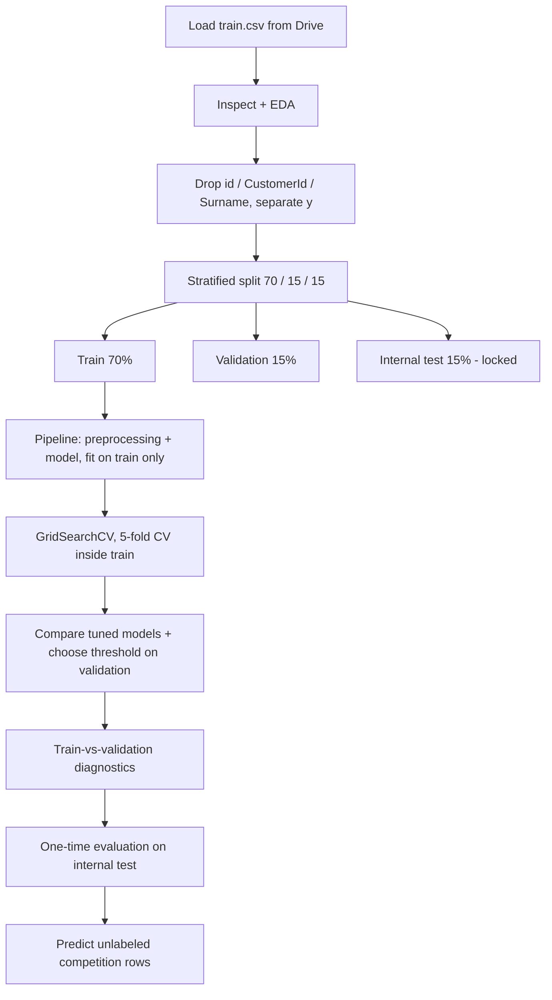

# 01 — অ্যাসাইনমেন্ট ও ওয়ার্কফ্লো

> **📌 এক নজরে**
> এই প্রজেক্টটি CSE 4101 ল্যাব অ্যাসাইনমেন্ট ১০: একটি ব্যাংক গ্রাহক শেষ পর্যন্ত ব্যাংক ছেড়ে চলে যাবে কি না (`Exited = 1`) তা আগে থেকে অনুমান করা। ডেটা বিভাজন → প্রি-প্রসেসিং → মডেল তুলনা → টিউনিং → একবারমাত্র চূড়ান্ত টেস্ট — এই ক্রমটি কেন গুরুত্বপূর্ণ, তা এই ডকুমেন্টে ব্যাখ্যা করা হয়েছে।

## 1. লক্ষ্য

CSE 4101 Practical Lab Assignment 10-এ একটি সম্পূর্ণ ও **leakage-free** মেশিন লার্নিং ওয়ার্কফ্লো তৈরি করতে বলা হয়েছে, যার মাধ্যমে **bank customer churn** (গ্রাহক ব্যাংক ছেড়ে যাওয়া) অনুমান করা হয়। কাজটি *supervised binary classification*: যেসব সারির উত্তর (`Exited`) জানা আছে, মডেল সেগুলো থেকে শেখে; তারপর যে সারি সে আগে কখনো দেখেনি, সেগুলোর ওপর তার মূল্যায়ন করা হয়।

## 2. ডেটাসেট ও টার্গেট

* **উৎস:** Kaggle প্রতিযোগিতা *Bank Customer Churn Prediction (2026)* — `train.csv` (লেবেলযুক্ত) ও `test.csv` (লেবেলবিহীন)।
* **Colab-এ অবস্থান:** `/content/drive/MyDrive/Customer Churn Prediction/train.csv`। লোকাল ডেভেলপমেন্ট কপি: `data/train.csv`।
* **টার্গেট:** `Exited` — `1` = গ্রাহক চলে গেছেন (**positive class**), `0` = থেকে গেছেন। CSV-তে এটি `0.0/1.0` ফ্লোট হিসেবে আছে; নোটবুক মান যাচাই করে `int`-এ রূপান্তর করে।
* **প্রকৃত আকার:** লোকাল কপিতে নোটবুক চালিয়ে পাওয়া গেছে ১৫,০০০ সারি × ১৪ কলাম; চার্নার ৩,০৪৬ জন (২০.৩১%)।

## 3. টাস্ক ও নোটবুক সেকশনের সম্পর্ক

অ্যাসাইনমেন্টের ১০টি টাস্ক নোটবুকের ক্রমানুসারে সাজানো। নিচের টেবিলে প্রতিটি টাস্ক কোন সেকশনে আছে এবং কী আউটপুট দেয়, তা দেখানো হলো।

| টাস্ক | নোটবুক সেকশন | প্রধান আউটপুট |
|---|---|---|
| ১ ডেটা লোড ও পরিদর্শন | §2–3 | shape, dtypes, missing value, duplicate, target distribution ও পর্যবেক্ষণ |
| ২ এক্সপ্লোরেটরি ডেটা অ্যানালাইসিস (EDA) | §4 | ৭টি plot (৬-প্যানেল চিত্র + tenure/balance চিত্র), গ্রুপ-টেবিল, স্বয়ংক্রিয়ভাবে তৈরি পর্যবেক্ষণ |
| ৩ আইডেন্টিফায়ার ও লিকেজ পর্যালোচনা | §5 | সিদ্ধান্ত-টেবিল (`column / decision / reason`), correlation যাচাই, ফিচার-তালিকা |
| ৪ স্ট্র্যাটিফাইড ৭০/১৫/১৫ বিভাজন | §6 | split টেবিল, disjointness assert, churn-rate বার চার্ট |
| ৫ লিকেজমুক্ত প্রি-প্রসেসিং | §7 | `ColumnTransformer` pipeline, শুধু-training পরিসংখ্যানের যাচাই-টেবিল, অদেখা-category প্রোব |
| ৬ তিনটি ক্লাসিফায়ার | §8 | validation তুলনা-টেবিল ও নথিভুক্ত কনফিগারেশন |
| ৭ হাইপারপ্যারামিটার টিউনিং | §9 | প্রতিটি সেটিংয়ের `GridSearchCV` টেবিল, CV বার প্লট, নির্বাচিত মডেল, threshold প্লট |
| ৮ ট্রেইন বনাম ভ্যালিডেশন | §10 | Recall/F1/ROC-AUC টেবিল ও গ্রুপ-করা বার চার্ট |
| ৯ অভ্যন্তরীণ টেস্ট (একবারমাত্র) | §11 | চূড়ান্ত metric, লেবেলযুক্ত confusion matrix |
| ১০ প্রতিযোগিতার ভবিষ্যদ্বাণী ও উপসংহার | §12–13 | পাঁচ-সারির prediction টেবিল, সারসংক্ষেপ, সীমাবদ্ধতা |

## 4. ওয়ার্কফ্লো

ডেটা লোড ও পরিদর্শনের পর শনাক্তকারী কলাম (`id`, `CustomerId`, `Surname`) বাদ দেওয়া হয়, তারপর ৭০/১৫/১৫ স্ট্র্যাটিফাইড বিভাজন। প্রশিক্ষণ অংশে প্রি-প্রসেসিংসহ pipeline ফিট হয় এবং 5-fold cross-validation চলে; ভ্যালিডেশনে মডেল ও threshold নির্বাচন হয়; সবশেষে *লক করা* internal test সেট একবার মাত্র ব্যবহৃত হয় এবং লেবেলহীন প্রতিযোগিতার সারিতে ভবিষ্যদ্বাণী করা হয়।

## 5. ক্রমটি কেন গুরুত্বপূর্ণ

1. **কিছু ফিট করার আগেই ডেটা ভাগ করুন।** Imputer-এর median, scaler-এর mean এবং encoder-এর category — সবই ডেটা থেকে শেখা হয়। সব সারি থেকে শিখলে এগুলোতে validation/test সারির তথ্য ঢুকে পড়ে (**leakage**), ফলে স্কোর বাস্তবের চেয়ে ভালো দেখায়।
2. **টেস্ট সেট ছোঁয়ার আগেই টিউনিং শেষ করুন।** যে সিদ্ধান্ত (মডেল, হাইপারপ্যারামিটার, threshold) কোনো স্কোর দেখে নেওয়া হয়, সেই স্কোর আশাবাদী হয়ে যায়। তাই internal test সেট শুধু *চূড়ান্ত* পছন্দটি দেখে।
3. **চূড়ান্ত টেস্টের আগে ডায়াগনসিস করুন।** Train-vs-validation তুলনা থেকে overfitting বোঝা যায়, এবং এতে এমন ডেটা ব্যবহার হয় যা দেখার অনুমতি আমাদের আছে।

## 6. প্রয়োজনীয়তার চেকলিস্ট

নিচের টেবিলে প্রতিটি শর্ত কোথায় পূরণ হয়েছে এবং কোনটি বাস্তবে চালানো হয়েছে তা দেখানো হয়েছে। উল্লেখ্য, Drive mount অংশটি ডেভেলপমেন্ট পরিবেশে **চালানো হয়নি** (সেখানে Colab ছিল না)।

| শর্ত | কোথায় | অবস্থা |
|---|---|---|
| Drive-first লোডিং, পথ যাচাই, কার্যকর error বার্তা | §2 | বাস্তবায়িত; Drive mount নিজে **চালানো হয়নি** (এখানে Colab নেই) |
| রানটাইমে টার্গেট যাচাই | §2 | লোকালি চালানো হয়েছে |
| ≥৩টি plot, ≥৩টি পর্যবেক্ষণ | §4 | লোকালি চালানো হয়েছে |
| seed 42 সহ stratified ৭০/১৫/১৫ | §6 | লোকালি চালানো হয়েছে |
| প্রি-প্রসেসিং শুধু train-এ ফিট, CV-র ভেতরে | §7, §9 | লোকালি চালানো হয়েছে |
| Recall, F1, ROC-AUC (+Precision, Accuracy)-এ LR, RF, GB তুলনা | §8 | লোকালি চালানো হয়েছে |
| ≥২টি হাইপারপ্যারামিটার টিউন, internal test অব্যবহৃত | §9 | লোকালি চালানো হয়েছে |
| Train বনাম validation টেবিল + চার্ট | §10 | লোকালি চালানো হয়েছে |
| একবারের test মূল্যায়ন + confusion matrix | §11 | লোকালি চালানো হয়েছে |
| ৫টি লেবেলহীন prediction | §12 | `data/test.csv` ব্যবহার করে লোকালি চালানো হয়েছে; ফাইল না থাকলে সুন্দরভাবে সামলানো হয় |
| ≥২টি সীমাবদ্ধতা | §13 | লেখা হয়েছে |
